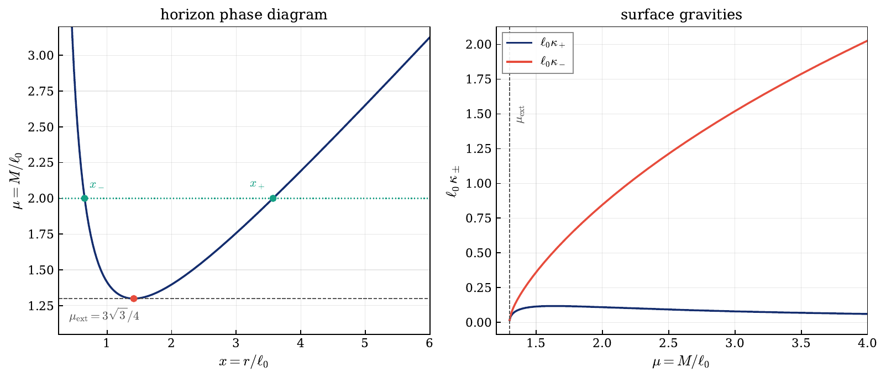

<!--
  Authorship:
    Davide Batic  (Mathematics Department, Khalifa University of Science and
                   Technology, Abu Dhabi, UAE)
    Denys Dutykh  (Mathematics Department, Khalifa University of Science and
                   Technology, Abu Dhabi, UAE)
-->

# tduality-bh: global and dynamical viability of the T-duality-inspired Bardeen regular black hole



The horizons of the black hole, in units of the zero-point length ℓ₀. On the left, the mass μ = M/ℓ₀ for which the radius x = r/ℓ₀ is a horizon, μ = (x² + 1)^(3/2)/(2x²): above the extremal value μ_ext = 3√3/4 ≈ 1.299, reached at x = √2, every mass has an inner horizon x₋ and an outer horizon x₊ (for μ = 2, marked by the dotted line, x₋ ≈ 0.652 and x₊ ≈ 3.572); the two merge at extremality and disappear below it. On the right, the surface gravities of the outer horizon, ℓ₀κ₊, and of the inner (Cauchy) horizon, ℓ₀κ₋, against μ: both vanish at extremality, and at large mass the inner one grows like √(2μ) while the outer one decays like 1/(4μ) (at μ = 4, ℓ₀κ₋ ≈ 2.03 and ℓ₀κ₊ ≈ 0.061). The figure is the one of the manuscript, drawn by `python/fig_horizon_phase_kappa.py`.

These codes accompany the article by Davide Batic and Denys Dutykh, published in Annals of Physics (volume 496, article 170842, January 2027), on the T-duality-inspired Bardeen black hole: the regular black hole whose static lapse is that of Bardeen with the magnetic charge replaced by the zero-point length that string T-duality induces in the propagator. The article separates four questions that are often merged, namely local curvature regularity, the extension of geodesics, the mode stability of test fields outside the black hole, and the dynamical stability of the inner Cauchy horizon. Python scripts draw the figures of the manuscript and check its closed forms, a Julia script reproduces its proper-time comparison, and Maple worksheets with a Julia solver compute quasinormal modes of scalar and electromagnetic test fields by Chebyshev collocation in high precision. An author version of the manuscript, dated 6 September 2026, is included as `pdf/T_Dual_BHs_Geodesic_Completeness.pdf`; the version of record is the published article, given with its DOI under "How to cite" below.

## The problem

The line element is static and spherically symmetric, with the mass function and the lapse

```text
ds² = −f(r) dt² + dr²/f(r) + r² dΩ²,     f(r) = 1 − 2 m(r)/r,
m(r) = M r³ / (r² + ℓ₀²)^(3/2),         so that   f(r) = 1 − 2 M r² / (r² + ℓ₀²)^(3/2),
```

where M is the mass and ℓ₀ the zero-point length. With x = r/ℓ₀ and μ = M/ℓ₀ the black-hole branch is μ > 3√3/4, with an inner and an outer horizon; the core is regular, and the article examines whether causal geodesics end or continue, how the photon spheres and light rings are arranged (including a horizonless ultracompact branch), how the inner horizon responds to the ingoing flux (mass inflation, with and without a filter of the flux by the zero-point length), and why massless scalar and electromagnetic test fields outside the black hole have no exponentially growing mode.

## Quick start

The Python scripts run from the folder `python/`, each in a few seconds:

```bash
pip install numpy scipy matplotlib
cd python
for f in fig_*.py; do python "$f"; done     # the six figures of the manuscript
python check_Abetas.py                       # the Bessel moment of the filtered mass inflation
```

Each figure script writes its PDF into the folder `latex/figures/` at the root of the repository, which it creates when needed; the six PDFs stored in `figures/` are the figures of the manuscript, and the scripts draw them again identically. Several scripts also assert the analytic special radii and asymptotics they draw, so that a successful run checks those closed forms as well. The Julia script needs its environment once, then writes `tau_comparison.pdf` into the current folder:

```bash
julia --project=julia -e 'using Pkg; Pkg.instantiate()'
julia --project=julia julia/tau_comparison.jl
```

The quasinormal modes need Maple to assemble the matrices first, and are described below.

## Contents

| Path | Contents |
| --- | --- |
| `python/` | the figure scripts `fig_geodesic_potentials.py`, `fig_three_scale_diagnostic.py`, `fig_lightring_structure.py`, `fig_horizon_phase_kappa.py`, `fig_tduality_filter.py` and `fig_proper_time_comparison.py`, their style file `ku_style.py`, and the check `check_Abetas.py` |
| `figures/` | the six figures of the manuscript, in PDF |
| `julia/` | `Project.toml` (the environment), `tau_comparison.jl` (the proper-time comparison) and `TD_spectral_solver_with_unstable_check.jl` (the quasinormal-mode solver) |
| `maple/` | `01-CASE-s0_s1-SUPPLEMENTAL MATERIAL.mw` (the derivation of the master equation) and `Matrix_Assembler_all_s_TD-Final Version.mw` (the Chebyshev assembler) |
| `pdf/` | the manuscript |
| `docs/figures/` | the figure of this page, a PNG image of `figures/horizon_phase_kappa.pdf` |

The six figure scripts draw the following.

| Script | Figure |
| --- | --- |
| `fig_geodesic_potentials.py` | timelike and null effective potentials; the centrifugal barrier keeps non-radial geodesics away from r = 0 |
| `fig_three_scale_diagnostic.py` | the Newtonian, Ricci-focusing and Raychaudhuri radial diagnostics of the core, with their three distinct scales |
| `fig_lightring_structure.py` | the thresholds of horizons and circular null orbits in the plane (x, μ), with the horizonless ultracompact band |
| `fig_horizon_phase_kappa.py` | the horizon phase diagram and the surface gravities ℓ₀κ₊ and ℓ₀κ₋ |
| `fig_tduality_filter.py` | the form factor of the zero-point length and the mass inflation at the Cauchy horizon, classical and filtered |
| `fig_proper_time_comparison.py` | the exact proper time against the endpoint prescription along the Painlevé–Gullstrand congruence |

## Requirements

The Python scripts need Python 3 with NumPy, SciPy and Matplotlib (`check_Abetas.py` needs only SciPy); they use Matplotlib's own mathematical fonts, not LaTeX, and no environment is pinned. The Julia scripts need Julia 1.10 or later (they were run with Julia 1.12 and 1.13); `julia/Project.toml` declares their three registered packages, Plots for the figures, PlotlyJS for the interactive scatter plots of the spectra, and GenericSchur for the eigenvalues of matrices in `BigFloat` arithmetic, besides the standard libraries DelimitedFiles, Printf, LinearAlgebra and Base.Threads. The two worksheets need Maple 2024 (packages LinearAlgebra, FileTools, ExportMatrix and PDEtools); the assembler works with 200 decimal digits, so `kernelopts(maxdigits)` must be at least 200.

## The proper-time comparison in Julia

The script `julia/tau_comparison.jl` is the Julia counterpart of `fig_proper_time_comparison.py`. Along the radially infalling Painlevé–Gullstrand congruence it compares the exact proper time τ_exact(r), obtained by integrating dr/dτ = −v(r) in closed form, with the endpoint expression τ_JN(r) that follows from replacing the Raychaudhuri integral by τ F(r). The two curves belong to the same congruence but behave differently at small r, logarithmically against a power law, which is the point of the figure. Its parameters are fixed in the file: M = 5, ℓ₀ = 1 and the initial radius r_i = 4ℓ₀.

## Quasinormal modes by Chebyshev collocation

The worksheets and the solver compute the quasinormal modes of massless scalar (s = 0) and electromagnetic (s = 1) test fields outside the black hole, in three stages. The worksheet `maple/01-CASE-s0_s1-SUPPLEMENTAL MATERIAL.mw` derives the master equation of both sectors, maps it to a compact coordinate and produces the coefficient functions `L00`, …, `L22` of the 3 × 3 pencil with their limits at the ends of the interval; it is purely symbolic, writes nothing to disk, and asks for a restart of Maple at two marked points, which must be followed when it is run from top to bottom. The worksheet `maple/Matrix_Assembler_all_s_TD-Final Version.mw` discretises the master equation by Chebyshev collocation and exports the matrices of the quadratic pencil

```text
M0 + i Ω M1 + Ω² M2 = 0
```

at the three resolutions N = 190, 195 and 200 (`nmin`, `nstep`, `nmax` = 190, 5, 200), as MATLAB ASCII files `M0-<N>-<filetag>.mat`, `M1-<N>-<filetag>.mat` and `M2-<N>-<filetag>.mat` in a folder `data/`, where `filetag = s<S>_L<L>_q<Q>` (for example `s0_L0_q0`). The sector (`s`, `L`, `q`) and the output folder are set near the top of the worksheet, and the resolutions must match `N_VALS` in the Julia solver.

The solver `julia/TD_spectral_solver_with_unstable_check.jl` reads these matrices, turns the quadratic pencil into a generalised eigenvalue problem and solves it in `BigFloat` arithmetic with 220 decimal digits. It discards the static mode Ω = 0 and keeps the damped modes, under the convention exp(−iωt); it keeps the modes that agree across the three resolutions to the tolerance 10⁻⁴, and separates the oscillatory modes from the purely imaginary ones. It also scans the unfiltered spectra for roots with Im Ω > 0, which would be growing modes, and its report says "No unstable mode detected." when none survives the comparison of resolutions. This scan is a numerical counterpart of the exterior mode stability that the article proves, for these two fields on the black-hole branch; it says nothing about the inner horizon, whose mass inflation the article treats separately. The manuscript reports no frequency computed with these codes: it relates the eikonal modes to the light ring and leaves the full spectral computation to further work. No matrix or spectrum is stored in this repository: they are produced by running the worksheets and the solver. The sector is chosen by the constants `SPIN`, `ELL` and `DEFORMATION_TAG` at the top of the solver, which must match the `filetag` of the assembler, and the folder of the matrices by an environment variable:

```bash
export TD_DATA_DIR=/path/to/data      # folder of the M0, M1 and M2 files
export TD_OUT_DIR=/path/to/output     # optional; by default TD_DATA_DIR/Julia/<filetag>
julia --project=julia -t auto julia/TD_spectral_solver_with_unstable_check.jl
```

Without `TD_DATA_DIR`, the solver looks for a folder `data/` beside `julia/`; the option `-t auto` lets it use several threads. It writes into the output folder, for the three resolutions N and the given `filetag`, the following files.

| File | Contents |
| --- | --- |
| `spectrum_finite-N<N>-<filetag>.dat` | the finite generalised eigenvalues |
| `spectrum_candidates-N<N>-<filetag>.dat` | the spectrum left by the physical filters |
| `stable_modes-<filetag>.txt` | the damped modes that agree across resolutions, with their differences |
| `stable_modes-<filetag>_details.txt` | the same modes, one by one |
| `stable_modes-<filetag>_full_precision.txt` | the same modes with all their digits |
| `stable_modes_oscillatory-<filetag>.dat` | the oscillatory modes among them |
| `stable_modes_pure_imag-<filetag>.dat` | the purely imaginary modes among them |
| `unstable_candidates-N<N>-<filetag>.txt` | the roots with Im Ω > 0 at each resolution |
| `unstable_modes-<filetag>.txt` and variants | the growing modes that agree across resolutions, or the notice that there are none |
| `qnm_plot*-<filetag>.png` and `.html` | scatter plots of the spectra in the plane (Re Ω, Im Ω) |

## The Bessel moment of the filtered mass inflation

The script `python/check_Abetas.py` checks the product of Gamma functions that the manuscript gives for the Bessel moment which controls the filtered mass inflation at the Cauchy horizon,

```text
                ∞
 A_{beta,s}  =  ∫  y^(beta+s+2) K₁(y)² dy
                0

                √π · Γ((beta+s+3)/2) · Γ((beta+s+5)/2) · Γ((beta+s+1)/2)
             =  ────────────────────────────────────────────────────────
                                  4 · Γ((beta+s+4)/2)
```

where `beta` is the infrared spectral index of the ingoing tail and `s` the power of the polynomial prefactor of the local frequency. They enter only through the sum beta + s, which must exceed −1 for the integral to converge. The script evaluates the integral itself with `scipy.integrate.quad`, split at y = 1 so that the algebraic behaviour near the origin and the exponential decay at infinity are treated by separate adaptive quadratures, and compares it with the closed form, which it never uses to compute the integral. Four pairs (beta, s) are sampled: a flat spectrum without prefactor, a regular spectrum with beta = 1, a quadratic prefactor s = 2, and a half-integer combination. The script imports nothing else from `python/`, so it runs from any folder; it prints a table and the largest relative difference, and exits with a nonzero status if that difference exceeds 10⁻¹². With SciPy 1.16 to 1.18 the largest difference is 8.4 × 10⁻¹⁶.

## How to cite

If you use these codes, please cite the article:

D. Batic and D. Dutykh, Global and dynamical viability of the T-duality-inspired Bardeen regular black hole, Annals of Physics 496, 170842 (2027). The article was published online on 16 November 2026.

https://doi.org/10.1016/j.aop.2026.170842

```bibtex
@article{Batic2027,
  author = {Batic, Davide and Dutykh, Denys},
  title = {Global and Dynamical Viability of the {{T}}-Duality-Inspired {{Bardeen}} Regular Black Hole},
  journal = {Annals of Physics},
  year = 2027,
  volume = {496},
  pages = {170842},
  doi = {10.1016/j.aop.2026.170842}
}
```

The button "Cite this repository" in the right-hand column of this page gives the same reference, in the formats APA and BibTeX, read from `CITATION.cff`.

## Licence

GNU Lesser General Public License, version 2.1 (see `LICENSE`).

## Authors

Davide Batic (davide.batic@ku.ac.ae) and Denys Dutykh (denys.dutykh@ku.ac.ae), Mathematics Department, Khalifa University of Science and Technology, Abu Dhabi, United Arab Emirates.

https://www.denys-dutykh.com/
